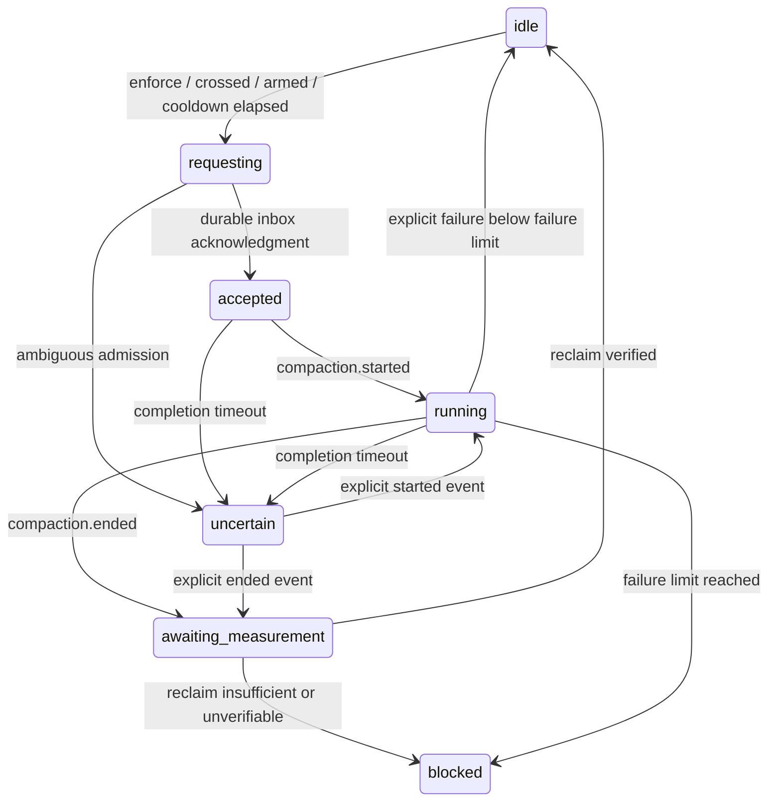

# Architecture

The domain modules import no OpenCode packages. `src/index.ts` is the public V2 package entrypoint; `src/adapter.ts` is the SDK boundary.

| Component                                | Responsibility                                                                                             |
| ---------------------------------------- | ---------------------------------------------------------------------------------------------------------- |
| ContextMonitor                           | Per-session identity, model transitions, usage and totals, peak, durable sequence deduplication, retention |
| PolicyResolver                           | Last-match policy selection with ANDed selectors                                                           |
| ThresholdEvaluator (`evaluateThreshold`) | Pure capacity and threshold calculation, provenance freshness checks                                       |
| CompactionScheduler                      | Deferred admission, lifecycle states, cooldown, hysteresis, failure circuit and ambiguity handling         |
| TelemetrySink                            | Structured scalar events; JSONL implementation with bounded queue/rotation                                 |
| ContextUsageProvider                     | Async usage snapshot contract, implemented by the monitor; alternate collectors can feed measurements      |
| BudgetController                         | Synchronous policy extension with a no-op default                                                          |

Ended events may precede the admission response; acknowledgment never overwrites a newer lifecycle state. The session owns one compaction at a time, including compactions initiated by users or OpenCode. Failed events invalidate old usage before any retry. An unsuccessful reclaim disarms automatic requests; a fresh context below `threshold - minReclaimTokens` rearms it. A successful reclaim also requires that low-water mark before another threshold crossing. Reclaim verification compares reported prompts on the same model; it is not the summary request's output size. Added intervening work can make reclaim appear insufficient; the safe result is suppression.

The adapter subscribes to step, compaction and execution lifecycle events for every session in its location. Session metadata supplies hierarchy and cumulative totals. Per-step identities prevent old-model usage attribution. Metadata calls do not read full transcripts. Models are cached for 60 seconds. If observed models are missing from the startup catalog, metadata retries back off from one to 60 seconds and repair resident limits without independently evaluating enforcement. Hooks place numeric snapshots into a bounded/coalescing map; a 100 ms worker handles them outside the hook call stack. Event handling and hook processing are serialized to avoid concurrent metadata updates. Each session has independent scheduler state; multiple child requests can be pending concurrently.

A public event stream carries events beyond one plugin location; directory ownership checks avoid duplicate cross-location controllers. Install globally to activate a plugin instance in each location. No server-wide guarantee is made for locations that did not load the plugin.

Safety state is persisted under one bounded plugin-storage key before admission and after lifecycle transitions. It contains phase, counts, failure streak, cooldown timestamps, request ID and durable event sequence, never content. Restart converts unresolved states to `uncertain`; the implementation does not scan all messages or invent completion. Pending/uncertain sessions are never evicted to make room for fresh automatic requests. Inactive idle/blocked states expire after TTL. Capacity overflow emits an explicit degraded event; it does not grow maps without bound. Undiscovered persisted safety records count toward capacity and remain retained until that session is observed/deleted.

Shutdown disposes hook registrations, aborts the event subscription and request signals, cancels deferred admission, drains bounded work and telemetry, and persists final safety state. An event-stream interruption stops enforcement for the instance while observation attempts reconnect. Reload is required to restore enforcement; persisted uncertain sessions remain suppressed. Failed safety reads never overwrite unknown persisted state.

## Native TUI projection

`src/snapshot.ts` projects immutable scalar measurements, pure policy decisions and final scheduler phases into a bounded resident store. The adapter observes diagnostics even when telemetry is disabled, marks final serialized mutations, and captures asynchronous scheduler transitions without adding a second monitor. Location epochs, globally increasing row revisions and sequenced batches distinguish restart, replacement and eviction. Deletion and retention eviction have distinct tombstones. Reads flush current projection and return explicit unknown IDs without evaluating enforcement.

`src/rpc.ts` defines the versioned `context-guard.monitor.v1` read/event contract with closed JSON schemas and runtime narrowing. `src/snapshotserver.ts` owns registration and a bounded emission queue, retries failures, and isolates slow clients from monitoring. Queue overflow may cause sequence gaps; selected-ID reads repair them. Payloads contain no titles, prompts, summaries, credentials, arbitrary errors or tool output.

Selected-ID snapshot reads can lazily discover idle sessions predating installation. When usage is missing, the adapter reads the public `session.context` API and selects the latest assistant usage after completed compaction and before the revert boundary, matching the pinned client's native selection rule. It retains only normalized prompt tokens, model identity and the original request timestamp/ID. Current-context message content is transient and never projected or logged. Reads share the serialized adapter queue, have a five-second batch deadline and bounded 30-second negative-lookup throttling. Existing measurements, active sessions and unresolved/previously observed compaction safety state are preserved. Bootstrap sets scalar observation state without policy evaluation or scheduler calls; snapshot projection remains pure. Stale occupancy remains visible while pressure decisions remain unknown.

`src/tui/transport.ts` supervises live subscriptions, bootstrap buffering, revisions, per-ID read baselines, chunked reconciliation, deadlines and capped retries. `src/tui/inventory.ts` discovers a bounded family with resumable breadth-first pagination through public SDK calls. `src/family.ts` keeps hierarchy and execution reduction harness-independent. Native metadata supplies current execution and outcomes; step-end and idle alone never establish success. Location-specific server time plus monotonic elapsed time supplies measurement age.

`src/tui.tsx` registers additive sidebar/panel contributions and palette/slash access. A shared state object reference-counts mounted consumers. The panel owns one consumer across Overview, Details, and performance Charts. Compact Overview keeps a selected-session summary above a windowed family list; Details contains the selected session's context chart and full diagnostics, plus explicitly route-scoped family statistics derived from unfolded rows. Sidebar defaults use an occupancy bar and compact agent rows; history disclosure and conservative completed grouping are local presentation state. The bounded descendant projection preserves attention-bearing ancestry and disables automatic grouping during untrustworthy discovery. Context traces continue updating while sidebar history is collapsed. Selection follows session identity, preserves sibling order during navigation, and falls back to the route session or first available row after removal. Context traces update while Overview is active, using the existing bounded store. Panel navigation uses public scroll, router, and focus APIs; only bounded expansion preferences are persisted. Public OpenTUI Solid runtime imports stay behind `./tui`; server/core imports require no renderer. Root-level `server.ts`, `tui.tsx` and `rpc.ts` support checkout-directory host resolution as well as package subpath exports.

The native Orbit workspace uses measured panel allocation (110 content cells × 28 usable rows) to split the family tree and active content into separate scroll viewports. `src/tui/workspaceformat.ts` provides pure geometry, occupancy/trigger and performance-freshness formatting; `src/tui/workspace.tsx` composes native Solid boxes/text without a dashboard controller. Recent context history in wide Overview uses the existing trace store, while retained history remains exclusive to Charts. Details and help retain independent content/tree scroll continuity. Native panel styling uses terminal-default foreground and ANSI slots without filling or changing the host background; the compact sidebar retains its host styling. The shared state exposes per-session server timing; its existing expiry timer also invalidates expired performance readings. Display masking removes current rates from stale/disconnected performance snapshots without changing stored metrics or measurement freshness.

`src/tui/statusformat.ts` shares renderer-free measurement, lifecycle, threshold, pressure, enforcement, and connection wording between the native sidebar/panel and standalone dashboard. It consumes existing projections without evaluating policy or issuing reads. Fresh threshold distance and last-measured occupancy remain distinct; disconnected status is explicitly last known. Reason-specific suspension messages preserve reload requirements after observation reconnects. Exact reason codes remain in Details.

Native panel help is local presentation state over the selected view, retaining selection, chart settings, and the source scroll offset. Help unmounts the retained-history renderer while keeping the bounded panel-owned request state and matching result. It aborts active chart reads and pauses polling until help closes, while preserving the panel's single monitor consumer and bounded context trace. `src/tui/panelcontrols.ts` formats inventory feedback and fits complete footer action targets within the measured cell width. Native state exposes read-only inventory progress and continuation eligibility from the existing bounded scan, with generation-checked start/settlement notifications. The global open command has no default binding but accepts an optional client plugin `openShortcut` through the public host keymap; supported hosts do not accept custom command IDs in their built-in keybind configuration.

## Standalone dashboard controller

`src/dashboard/connection.ts` owns one authenticated SDK client, projects session metadata to an approved scalar inventory contract and rebinds explicit directories without creating additional clients. `src/dashboard/port.ts` keeps controller/inventory code independent of SDK and renderer types. `src/dashboard/inventory.ts` performs bounded, location-scoped breadth-first root/child pagination. Native execution state comes from the public active-session API plus outcome metadata, never transcript inspection.

`src/dashboard/controller.ts` retains at most four location inventories and activates one shared `SnapshotClient` for the selected location. It owns selection, overview/detail/history navigation, filters, periodic inventory reconciliation and a 16-entry history cache. History reads are serialized and canceled on obsolete selection/window/location changes. `src/dashboard/view.ts` projects matched historical request summaries and preserves discontinuities and retention notices. Frontends receive cloned, recursively frozen scalar view models; failed reads retain explicit stale/unknown values. This layer imports no host TUI registration or renderer runtime. See [controller validation](validation/dashboard-controller-2026-10-22.md).

`src/dashboard/presentation.ts` composes the standalone Orbit workspace at 110×28 terminal cells using structured semantic spans, a windowed family rail, selected metrics and matching retained TPS history. It converts those spans to the renderer's default/indexed color intents after layout, without ANSI control strings in application data. Smaller layouts retain the existing shell's bounded columns/cards; both paths keep a plain-text frame for diagnostics and tests. Renderer constructors are injected after the CLI's lazy renderer load. Native panel composition remains independent and uses `GuardRow`, not dashboard controller contracts.

`src/dashboard/terminalview.ts` formats bounded Overview columns/cards and complete Detail diagnostics from that existing projection. `src/dashboard/terminal.ts` owns terminal presentation state, including the Overview offset, measured viewport/page size, editors, and chart cursors. Row reveal preserves the selected identity first and reduces cards when necessary; location/filter changes reset the offset, while updates and resize recompute row ranges. Full session IDs remain controller-owned selection keys; displayed suffixes or list positions only distinguish visible identities. Formatting and local navigation add no upstream reads or subscriptions. See [overview validation](validation/standalone-overview-density-2026-11-06.md).

## Distribution

The npm package `@cesarus777/opencode-cgp` keeps `context-guard` as its server/TUI ID. Four independently built ESM library entries and a Bun CLI preserve the server, harness-independent core, shared RPC and native TUI boundaries; `./server` aliases the main entry. TypeScript declarations accompany every public export. The TUI uses the public Solid compiler ahead of publication; package imports remain external so OpenCode can provide shared SDK and renderer instances. Server-only consumers need no optional renderer peers. Only JavaScript, declarations, README, license and manifest ship. Checkout-directory wrappers remain source entries. See [build and dependency details](releasing.md#package-layout-and-runtime-boundary).

## Performance observation

`PerformanceTracker` is exported through core and accepts scalar request boundaries/output increments with an injected clock. It owns bounded per-session aggregates, current request identity, 100 ms rolling buckets and a 256-event transient deduplication window. Adapter handling of text/reasoning deltas extracts character counts and timestamps without retaining content or doing metadata/storage work. Durable request boundaries use sequence deduplication; stream completion stops the model clock before subsequent tool completion. Missing boundaries never acquire invented durations.

The snapshot store projects performance at the configured cadence. Both monitor RPC versions share epochs/revisions and the version-1 envelope; v1 removes performance fields and v2 validates the extended row contract. TUI consumers negotiate per location and share one live subscription.

`PerformanceHistory` owns a separate bounded async JSONL archive with age/size pruning and scalar projection. Compact performance checkpoints use a separate plugin-storage key, independent of admission safety. No archive or checkpoint failure suspends enforcement. History exports and offline reports use the local CLI. A separate read-only history RPC serves bounded, location-authorized session windows for terminal charts; it reads only scalar archive records and never transcripts. Neither archive reads nor chart failures evaluate or change enforcement.

## Chart projections

`src/modelanalytics.ts` exports harness-independent `aggregateModels` through core. It reconciles scalar request facts from raw history records before any chart limits, groups by historical model identity and computes matched duration-weighted TPS and TTFT distributions with explicit eligibility counts and coverage. A distinct-request budget bounds aggregation memory. `src/modelcli.ts` joins that pure layer to the existing bounded filesystem reader and JSON/CSV exports; completion-time filtering occurs after reconciliation. The offline CLI uses no RPC or dashboard subscription; the standalone Models screen uses the separate analytics service described below.

`buildChartData` is exported through core and owns chronological ordering, per-instance grouping, event/request deduplication, discontinuities and extrema-preserving downsampling. It has no runtime SDK or filesystem dependency. Timestamped request records keep matched token/duration pairs for duration-weighted summaries. Historical session averages remain the collector's snapshots; filtering observations does not reinterpret their lifetime scope.

The CLI builds a self-contained offline HTML/SVG report with escaped embedded JSON, DOM text nodes for identities, and a network-blocking content policy. It is shipped as the Bun-backed `context-guard` executable as well as the checkout's `charts`/`inspect` scripts. The terminal panel keeps the shared live transport mounted and independently polls the new history RPC only in chart mode. History requests are serialized per location service, have capped windows/results, and accept no filesystem path from the client.

`src/historyclient.ts` validates retained-history responses and normalizes structured RPC failures to approved reason codes and fixed display text. Both native and standalone views use its recovery wording; arbitrary server errors never enter projected diagnostics. `src/tui/historystate.ts` owns a mounted native chart's single retained query, coalesced retry, generation-checked cancellation, and five-second polling after settlement. Its query includes resolved location, full session identity, and window; retained plots preserve their original range and successful receipt time. Missing/incompatible/rejected services and disabled recording pause native polling until an explicit check. Standalone history retains its existing serialized queue and bounded cache, adding failure reason and receipt time to its immutable projection.

## Retained model analytics

`src/modelanalytics.ts` reconciles scalar request identities once and shares its completed-request summaries with the CLI and `src/modelseries.ts` time buckets. Ratios use summed matched tokens/durations; quantiles use eligible request TTFTs, independently of pagination or plot resolution.

`src/modelanalyticsserver.ts` registers `context-guard.analytics.v1` against a server-owned location/archive. It coalesces cancellable archive reads, reuses normalized facts by validated archive revision in adapter setup (legacy injected readers retain the 30-second TTL), and retains at most two 90-second query snapshots. Models and request details paginate after aggregation, with query/model/sort-bound cursors; requests from archived sessions need no live inventory entry. The service never changes per-session History authorization or compaction behavior. The archive reader reads each segment's captured size, labels malformed/truncated records, and yields cancellation checks during large scans.

`src/dashboard/models.ts` owns location/filter/range cancellation, stale results, short-lived snapshot recovery, selection, sorting and pages. It uses the existing authenticated connection and controller publication, without another event stream. `src/dashboard/modelview.ts` supplies Models list/chart/request-detail text. Chart resizing reuses a query snapshot; metric and bucket inspection use local data. Existing monitors and session History remain compatible with older servers lacking analytics.

## Shared archive revisions and dashboard work

`src/archive.ts` owns one internal `PerformanceArchive` per adapter location and server-selected archive path. History and Models share its coalesced scans; disabled services perform no archive I/O. Each consumer has an independent abort waiter. The last waiter leaving cancels the job, and disposal aborts the services before the reader. History keeps its single-query admission guard and authorizes the session before every cache lookup. Models permits at most two concurrent query projections, with two retained snapshots, four model sorts and eight model/resolution bucket variants per snapshot.

The reader validates a chronological manifest using open/fstat identity, captured size and timestamps, then revalidates it before publication, with three attempts for an unstable archive. Notified append-only growth after capture is assigned to the next revision, so an active writer cannot starve a long scan; replacement, pruning and untrusted changes still retry. Unchanged decoded segments are reused. Writer append/prune notifications invalidate revisions; known append-only growth reads from the previous complete-line boundary and replaces the old valid or malformed tail contribution. External growth is conservatively reparsed. Replacement, shrink, rewrite, rotation and pruning invalidate affected entries. The append fast path assumes this instance owns its active segment. External writers must force a rebuild when changing an owned active file, and must not conceal other changes by restoring filesystem identity/timestamps; an internal forced rebuild is available for such mutations. Cache failure stays within existing unavailable/stale service behavior and never changes enforcement.

The decoded LRU accounts at most 64 MiB of encoded source data, 200,000 records and 256 segments. The record limit was tuned upward from the initial 100,000 after the synthetic 64 MiB workload demonstrated repeated eviction. Session offsets, global-gap offsets and validated segment time bounds allow History projections to skip unrelated decoded records. Index references are bounded by the decoded-record/segment limits; tails are represented by a byte boundary and their prior contribution, rather than retained raw strings. A scan's captured 64 MiB input, in-flight decoded snapshot, normalized Models facts and old query snapshots are separate transient allocations. Encoded accounting is not a JavaScript heap ceiling. Eviction changes work counts, never coverage or totals.

The one-shot CLI reader remains available. Both readers stream captured bytes in 64 KiB chunks and cooperate against a 4 ms monotonic time budget even without a caller signal. Parse errors alone increment malformed counts. Models uses the same reconciliation accumulator as the pure aggregator and applies suffix facts only when a retained immutable record prefix proves unchanged; uncertain prefixes, changed retention and evicted/reparsed records rebuild canonically. The 100,000 distinct-request stop position, duplicate/conflict handling, completion-time filters and metric eligibility remain unchanged. Revision validation replaces the adapter's fixed scan TTL, while old query snapshots retain their original 90-second expiry and immutable facts.

Overview identity labels and row layouts are bounded by the current inventory. A lightweight height index preserves paging and selected-ID reveal; only visible rows receive full identity/exception formatting. Unchanged immutable snapshot subtrees are reused across publications. Input/publication draws coalesce within a microtask, while resize draws stay synchronous for renderer geometry. Discovery publishes partial root/branch progress and probes up to four independent child branches at once; root pagination stays sequential, page reservations obey the existing global bound and results commit in deterministic batch order. Progress never removes older inventory or claims completeness. Idle-session usage restoration is unchanged.
