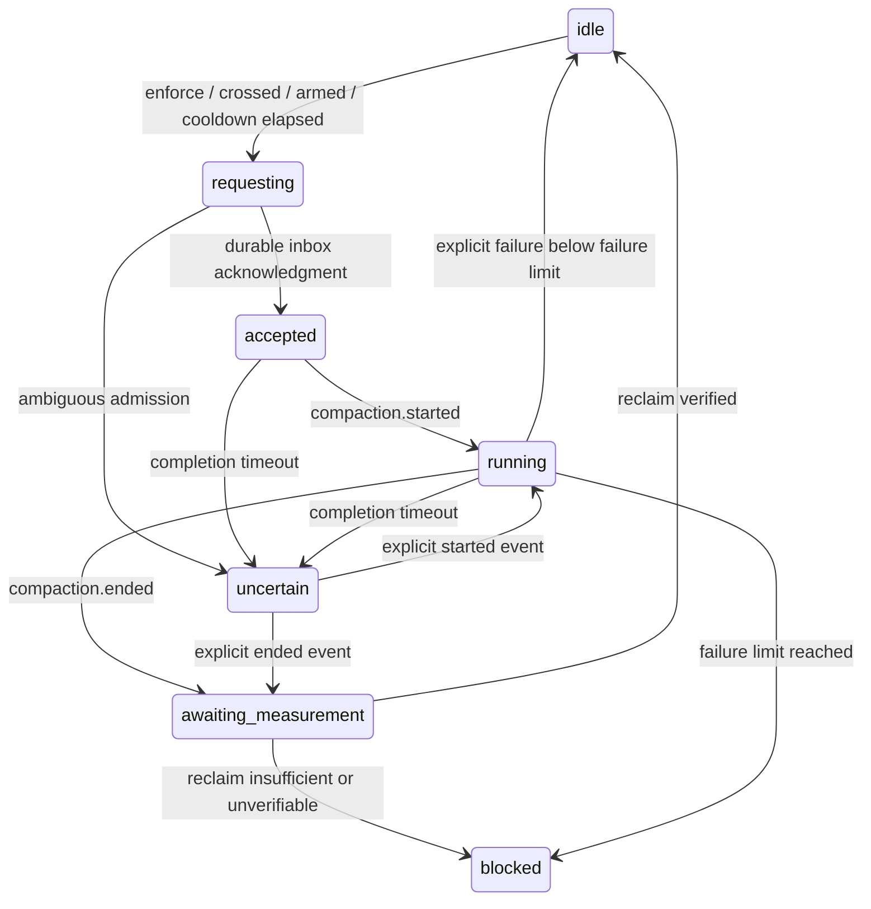

# Architecture

The domain modules import no OpenCode packages. `src/index.ts` is the public V2 package entrypoint; `src/adapter.ts` is the SDK boundary.

| Component                                | Responsibility                                                                                             |
| ---------------------------------------- | ---------------------------------------------------------------------------------------------------------- |
| ContextMonitor                           | Per-session identity, model transitions, usage and totals, peak, durable sequence deduplication, retention |
| PolicyResolver                           | Last-match policy selection with ANDed selectors                                                           |
| ThresholdEvaluator (`evaluateThreshold`) | Pure capacity and threshold calculation, provenance freshness checks                                       |
| CompactionScheduler                      | Deferred admission, lifecycle states, cooldown, hysteresis, failure circuit and ambiguity handling         |
| TelemetrySink                            | Structured scalar events; JSONL implementation with bounded queue/rotation                                 |
| ContextUsageProvider                     | Async usage snapshot contract, implemented by the monitor; alternate collectors can feed measurements      |
| BudgetController                         | Synchronous policy extension with a no-op default                                                          |

Ended events may precede the admission response; acknowledgment never overwrites a newer lifecycle state. The session owns one compaction at a time, including compactions initiated by users or OpenCode. Failed events invalidate old usage before any retry. An unsuccessful reclaim disarms automatic requests; a fresh context below `threshold - minReclaimTokens` rearms it. A successful reclaim also requires that low-water mark before another threshold crossing. Reclaim verification compares reported prompts on the same model; it is not the summary request's output size. Added intervening work can make reclaim appear insufficient; the safe result is suppression.

The adapter subscribes to step, compaction and execution lifecycle events for every session in its location. Session metadata supplies hierarchy and cumulative totals. Per-step identities prevent old-model usage attribution. Metadata calls do not read full transcripts. Models are cached for 60 seconds. If observed models are missing from the startup catalog, metadata retries back off from one to 60 seconds and repair resident limits without independently evaluating enforcement. Hooks place numeric snapshots into a bounded/coalescing map; a 100 ms worker handles them outside the hook call stack. Event handling and hook processing are serialized to avoid concurrent metadata updates. Each session has independent scheduler state; multiple child requests can be pending concurrently.

A public event stream carries events beyond one plugin location; directory ownership checks avoid duplicate cross-location controllers. Install globally to activate a plugin instance in each location. No server-wide guarantee is made for locations that did not load the plugin.

Safety state is persisted under one bounded plugin-storage key before admission and after lifecycle transitions. It contains phase, counts, failure streak, cooldown timestamps, request ID and durable event sequence, never content. Restart converts unresolved states to `uncertain`; the implementation does not scan all messages or invent completion. Pending/uncertain sessions are never evicted to make room for fresh automatic requests. Inactive idle/blocked states expire after TTL. Capacity overflow emits an explicit degraded event; it does not grow maps without bound. Undiscovered persisted safety records count toward capacity and remain retained until that session is observed/deleted.

Shutdown disposes hook registrations, aborts the event subscription and request signals, cancels deferred admission, drains bounded work and telemetry, and persists final safety state. An event-stream interruption stops enforcement for the instance while observation attempts reconnect. Reload is required to restore enforcement; persisted uncertain sessions remain suppressed. Failed safety reads never overwrite unknown persisted state.

## Native TUI projection

`src/snapshot.ts` projects immutable scalar measurements, pure policy decisions and final scheduler phases into a bounded resident store. The adapter observes diagnostics even when telemetry is disabled, marks final serialized mutations, and captures asynchronous scheduler transitions without adding a second monitor. Location epochs, globally increasing row revisions and sequenced batches distinguish restart, replacement and eviction. Deletion and retention eviction have distinct tombstones. Reads flush current projection and return explicit unknown IDs without evaluating enforcement.

`src/rpc.ts` defines the versioned `context-guard.monitor.v1` read/event contract with closed JSON schemas and runtime narrowing. `src/snapshotserver.ts` owns registration and a bounded emission queue, retries failures, and isolates slow clients from monitoring. Queue overflow may cause sequence gaps; selected-ID reads repair them. Payloads contain no titles, prompts, summaries, credentials, arbitrary errors or tool output.

Selected-ID snapshot reads can lazily discover idle sessions predating installation. When usage is missing, the adapter reads the public `session.context` API and selects the latest assistant usage after completed compaction and before the revert boundary, matching the pinned client's native selection rule. It retains only normalized prompt tokens, model identity and the original request timestamp/ID. Current-context message content is transient and never projected or logged. Reads share the serialized adapter queue, have a five-second batch deadline and bounded 30-second negative-lookup throttling. Existing measurements, active sessions and unresolved/previously observed compaction safety state are preserved. Bootstrap sets scalar observation state without policy evaluation or scheduler calls; snapshot projection remains pure. Stale occupancy remains visible while pressure decisions remain unknown.

`src/tui/transport.ts` supervises live subscriptions, bootstrap buffering, revisions, per-ID read baselines, chunked reconciliation, deadlines and capped retries. `src/tui/inventory.ts` discovers a bounded family with resumable breadth-first pagination through public SDK calls. `src/family.ts` keeps hierarchy and execution reduction harness-independent. Native metadata supplies current execution and outcomes; step-end and idle alone never establish success. Location-specific server time plus monotonic elapsed time supplies measurement age.

`src/tui.tsx` registers additive sidebar/panel contributions and palette/slash access. A shared state object reference-counts mounted consumers. The panel windows rows, preserves selected sibling order during navigation, uses supported router navigation and host focus, and persists only bounded expansion preferences. Public OpenTUI Solid runtime imports stay behind `./tui`; server/core imports require no renderer. Root-level `server.ts`, `tui.tsx` and `rpc.ts` support checkout-directory host resolution as well as package subpath exports.

## Standalone dashboard controller

`src/dashboard/connection.ts` owns one authenticated SDK client, projects session metadata to an approved scalar inventory contract and rebinds explicit directories without creating additional clients. `src/dashboard/port.ts` keeps controller/inventory code independent of SDK and renderer types. `src/dashboard/inventory.ts` performs bounded, location-scoped breadth-first root/child pagination. Native execution state comes from the public active-session API plus outcome metadata, never transcript inspection.

`src/dashboard/controller.ts` retains at most four location inventories and activates one shared `SnapshotClient` for the selected location. It owns selection, overview/detail/history navigation, filters, periodic inventory reconciliation and a 16-entry history cache. History reads are serialized and canceled on obsolete selection/window/location changes. `src/dashboard/view.ts` projects matched historical request summaries and preserves discontinuities and retention notices. Frontends receive cloned, recursively frozen scalar view models; failed reads retain explicit stale/unknown values. This layer imports no host TUI registration or renderer runtime. See [controller validation](validation/dashboard-controller-2026-10-22.md).

## Distribution

The npm package `@cesarus777/opencode-cgp` keeps `context-guard` as its server/TUI ID. Four independently built ESM library entries and a Bun CLI preserve the server, harness-independent core, shared RPC and native TUI boundaries; `./server` aliases the main entry. TypeScript declarations accompany every public export. The TUI uses the public Solid compiler ahead of publication; package imports remain external so OpenCode can provide shared SDK and renderer instances. Server-only consumers need no optional renderer peers. Only JavaScript, declarations, README, license and manifest ship. Checkout-directory wrappers remain source entries. See [build and dependency details](releasing.md#package-layout-and-runtime-boundary).

## Performance observation

`PerformanceTracker` is exported through core and accepts scalar request boundaries/output increments with an injected clock. It owns bounded per-session aggregates, current request identity, 100 ms rolling buckets and a 256-event transient deduplication window. Adapter handling of text/reasoning deltas extracts character counts and timestamps without retaining content or doing metadata/storage work. Durable request boundaries use sequence deduplication; stream completion stops the model clock before subsequent tool completion. Missing boundaries never acquire invented durations.

The snapshot store projects performance at the configured cadence. Both monitor RPC versions share epochs/revisions and the version-1 envelope; v1 removes performance fields and v2 validates the extended row contract. TUI consumers negotiate per location and share one live subscription.

`PerformanceHistory` owns a separate bounded async JSONL archive with age/size pruning and scalar projection. Compact performance checkpoints use a separate plugin-storage key, independent of admission safety. No archive or checkpoint failure suspends enforcement. History exports and offline reports use the local CLI. A separate read-only history RPC serves bounded, location-authorized session windows for terminal charts; it reads only scalar archive records and never transcripts. Neither archive reads nor chart failures evaluate or change enforcement.

## Chart projections

`src/modelanalytics.ts` exports harness-independent `aggregateModels` through core. It reconciles scalar request facts from raw history records before any chart limits, groups by historical model identity and computes matched duration-weighted TPS and TTFT distributions with explicit eligibility counts and coverage. A distinct-request budget bounds aggregation memory. `src/modelcli.ts` joins that pure layer to the existing bounded filesystem reader and JSON/CSV exports; completion-time filtering occurs after reconciliation. This offline feature does not add an RPC or dashboard subscription.

`buildChartData` is exported through core and owns chronological ordering, per-instance grouping, event/request deduplication, discontinuities and extrema-preserving downsampling. It has no runtime SDK or filesystem dependency. Timestamped request records keep matched token/duration pairs for duration-weighted summaries. Historical session averages remain the collector's snapshots; filtering observations does not reinterpret their lifetime scope.

The CLI builds a self-contained offline HTML/SVG report with escaped embedded JSON, DOM text nodes for identities, and a network-blocking content policy. It is shipped as the Bun-backed `context-guard` executable as well as the checkout's `charts`/`inspect` scripts. The terminal panel keeps the shared live transport mounted and independently polls the new history RPC only in chart mode. History requests are serialized per location service, have capped windows/results, and accept no filesystem path from the client.
