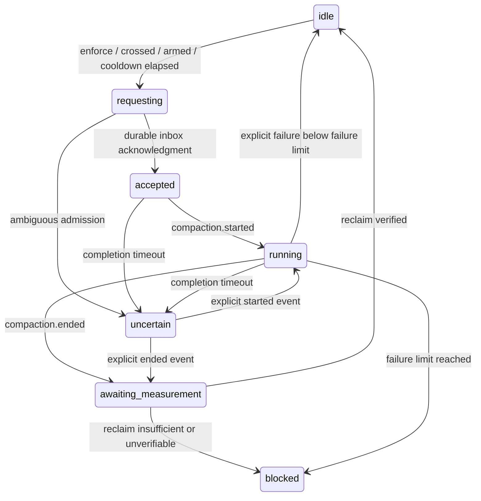

# Architecture

The domain modules import no OpenCode packages. `src/index.ts` is the public V2 package entrypoint; `src/adapter.ts` is the SDK boundary.

| Component                                | Responsibility                                                                                             |
| ---------------------------------------- | ---------------------------------------------------------------------------------------------------------- |
| ContextMonitor                           | Per-session identity, model transitions, usage and totals, peak, durable sequence deduplication, retention |
| PolicyResolver                           | Last-match policy selection with ANDed selectors                                                           |
| ThresholdEvaluator (`evaluateThreshold`) | Pure capacity and threshold calculation, provenance freshness checks                                       |
| CompactionScheduler                      | Deferred admission, lifecycle states, cooldown, hysteresis, failure circuit and ambiguity handling         |
| TelemetrySink                            | Structured scalar events; JSONL implementation with bounded queue/rotation                                 |
| ContextUsageProvider                     | Async usage snapshot contract, implemented by the monitor; alternate collectors can feed measurements      |
| BudgetController                         | Synchronous policy extension with a no-op default                                                          |

Ended events may precede the admission response; acknowledgment never overwrites a newer lifecycle state. The session owns one compaction at a time, including compactions initiated by users or OpenCode. Failed events invalidate old usage before any retry. An unsuccessful reclaim disarms automatic requests; a fresh context below `threshold - minReclaimTokens` rearms it. A successful reclaim also requires that low-water mark before another threshold crossing. Reclaim verification compares reported prompts on the same model; it is not the summary request's output size. Added intervening work can make reclaim appear insufficient; the safe result is suppression.

The adapter subscribes to step, compaction and execution lifecycle events for every session in its location. Session metadata supplies hierarchy and cumulative totals. Per-step identities prevent old-model usage attribution. Metadata calls do not read full transcripts. Models are cached for 60 seconds. Hooks place numeric snapshots into a bounded/coalescing map; a 100 ms worker handles them outside the hook call stack. Event handling and hook processing are serialized to avoid concurrent metadata updates. Each session has independent scheduler state; multiple child requests can be pending concurrently.

A public event stream carries events beyond one plugin location; directory ownership checks avoid duplicate cross-location controllers. Install globally to activate a plugin instance in each location. No server-wide guarantee is made for locations that did not load the plugin.

Safety state is persisted under one bounded plugin-storage key before admission and after lifecycle transitions. It contains phase, counts, failure streak, cooldown timestamps, request ID and durable event sequence, never content. Restart converts unresolved states to `uncertain`; the implementation does not scan all messages or invent completion. Pending/uncertain sessions are never evicted to make room for fresh automatic requests. Inactive idle/blocked states expire after TTL. Capacity overflow emits an explicit degraded event; it does not grow maps without bound. Undiscovered persisted safety records count toward capacity and remain retained until that session is observed/deleted.

Shutdown disposes hook registrations, aborts the event subscription and request signals, cancels deferred admission, drains bounded work and telemetry, and persists final safety state. An event-stream interruption stops enforcement for the instance while observation attempts reconnect. Reload is required to restore enforcement; persisted uncertain sessions remain suppressed. Failed safety reads never overwrite unknown persisted state.

## Native TUI projection

`src/snapshot.ts` projects immutable scalar measurements, pure policy decisions and final scheduler phases into a bounded resident store. The adapter observes diagnostics even when telemetry is disabled, marks final serialized mutations, and captures asynchronous scheduler transitions without adding a second monitor. Location epochs, globally increasing row revisions and sequenced batches distinguish restart, replacement and eviction. Deletion and retention eviction have distinct tombstones. Reads flush current projection and return explicit unknown IDs without evaluating enforcement.

`src/rpc.ts` defines the versioned `context-guard.monitor.v1` read/event contract with closed JSON schemas and runtime narrowing. `src/snapshotserver.ts` owns registration and a bounded emission queue, retries failures, and isolates slow clients from monitoring. Queue overflow may cause sequence gaps; selected-ID reads repair them. Payloads contain no titles, prompts, summaries, credentials, arbitrary errors or tool output.

`src/tui/transport.ts` supervises live subscriptions, bootstrap buffering, revisions, per-ID read baselines, chunked reconciliation, deadlines and capped retries. `src/tui/inventory.ts` discovers a bounded family with resumable breadth-first pagination through public SDK calls. `src/family.ts` keeps hierarchy and execution reduction harness-independent. Native metadata supplies current execution and outcomes; step-end and idle alone never establish success. Location-specific server time plus monotonic elapsed time supplies measurement age.

`src/tui.tsx` registers additive sidebar/panel contributions and palette/slash access. A shared state object reference-counts mounted consumers. The panel windows rows, preserves selected sibling order during navigation, uses supported router navigation and host focus, and persists only bounded expansion preferences. Public OpenTUI Solid runtime imports stay behind `./tui`; server/core imports require no renderer. Root-level `server.ts`, `tui.tsx` and `rpc.ts` support checkout-directory host resolution as well as package subpath exports.
