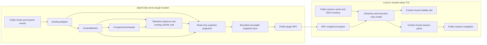

# Context Guard native TUI integration plan

Planning baseline: 2026-10-15. Status: implemented with offline validation on 2026-10-16; live host/environment gates remain open. The architecture/evidence below retains the original planning baseline. See [validation results](../testing.md#native-tui-offline-and-transport-checks) and [runtime controls and bounds](../configuration.md#native-context-guard-view). Follow the repository's Markdown/Prettier conventions. New paths below are proposed files, not claims that those files already exist.

## A. Executive summary

Native integration is feasible on the repository's pinned OpenCode V2 **2.0.29** SDK and matching inspected host source. The installed `@opencode/plugin` package exports `./tui`; its declarations support `Plugin.define`, Solid/OpenTUI components, and `context.ui.slot({ append: "sidebar.content", render })`. Public RPC methods and RPC events support a server-to-TUI bridge without files, a custom port, or a fork.

Recommend **B + C**: a versioned, immutable snapshot service owned by the existing server plugin; public OpenCode RPC for reads and live updates; native reactive session metadata for hierarchy, navigation, and execution status. Context Guard remains authoritative for context measurements, effective capacity, policy, and compaction state. Reuse existing accounting and pure policy functions. Keep JSONL telemetry as diagnostics, not the UI's state database.

There are material host limitations:

- The sidebar is host controlled: automatically visible in wide root sessions, an overlay when opened in narrow terminals, and **suppressed for child sessions** in the inspected host. A supported `session.panel` contribution and palette/slash command are therefore part of the minimum usable feature, including when navigating into a child. Do not promise a persistent sidebar on every route.
- Public session caches are incomplete inventories. Discover ancestors and paginated descendants through the public client, outside rendering. Show discovered but unmonitored sessions with unknown Context Guard measurements.
- The monitor discovers sessions lazily, per loaded location, and retains bounded state. Historical, evicted, cross-location, or pre-installation sessions may have no current measurement.
- Reported usage describes the last completed request; fallback usage estimates a prepared request. Neither proves the exact size of a future request. No continuous tokenizer or per-token usage stream is available here.
- RPC events are live only. Reconcile after disconnects and periodically while visible; never use UI reconnection to restore suspended enforcement.

Certification scope is 2.0.29, not all V2 releases. No live OpenCode binary/provider/TUI validation was performed for this plan. Earlier-version floors and later-version compatibility remain unverified.

## B. Verified API compatibility

### Evidence and reproducibility

Inspected repository `package.json`, `bun.lockb`, installed declarations/implementations under `node_modules/@opencode/{plugin,client}/dist`, and the existing official source checkout at `/tmp/context-guard-opencode`. Its `git rev-parse HEAD` is `4397ee44d038a5f17bf6ac161431673d93e563b5`; its TUI package declares version 2.0.29. Temporary checkout paths are research inputs, never implementation dependencies.

The following permanent source links are the evidence anchors used throughout this plan:

| ID  | Official source at inspected commit                                                                                                                                                                                                                                                                                                                                                                                                         | Evidence                                                                                        |
| --- | ------------------------------------------------------------------------------------------------------------------------------------------------------------------------------------------------------------------------------------------------------------------------------------------------------------------------------------------------------------------------------------------------------------------------------------------- | ----------------------------------------------------------------------------------------------- |
| S1  | [plugin package](https://github.com/anomalyco/opencode/blob/4397ee44d038a5f17bf6ac161431673d93e563b5/packages/plugin/package.json), [TUI definition](https://github.com/anomalyco/opencode/blob/4397ee44d038a5f17bf6ac161431673d93e563b5/packages/plugin/src/tui/plugin.ts), [TUI exports](https://github.com/anomalyco/opencode/blob/4397ee44d038a5f17bf6ac161431673d93e563b5/packages/plugin/src/tui/index.ts)                            | TUI subpath, separate TUI `Plugin.define`, setup cleanup contract, peers.                       |
| S2  | [public TUI context](https://github.com/anomalyco/opencode/blob/4397ee44d038a5f17bf6ac161431673d93e563b5/packages/plugin/src/tui/context.ts)                                                                                                                                                                                                                                                                                                | Slots and reactive props, data, renderer, theme, navigation, panel, dialog, keymaps.            |
| S3  | [host resolver](https://github.com/anomalyco/opencode/blob/4397ee44d038a5f17bf6ac161431673d93e563b5/packages/plugin/src/host.ts), [TUI plugin host](https://github.com/anomalyco/opencode/blob/4397ee44d038a5f17bf6ac161431673d93e563b5/packages/tui/src/plugin/context.tsx), [context adapter](https://github.com/anomalyco/opencode/blob/4397ee44d038a5f17bf6ac161431673d93e563b5/packages/tui/src/plugin/api.tsx)                        | Entry resolution, enable/reload/unload, owned registrations and cleanup.                        |
| S4  | [sidebar](https://github.com/anomalyco/opencode/blob/4397ee44d038a5f17bf6ac161431673d93e563b5/packages/tui/src/routes/session/sidebar.tsx), [session frame](https://github.com/anomalyco/opencode/blob/4397ee44d038a5f17bf6ac161431673d93e563b5/packages/tui/src/component/session-frame.tsx), [layout](https://github.com/anomalyco/opencode/blob/4397ee44d038a5f17bf6ac161431673d93e563b5/packages/tui/src/ui/layout.ts)                  | Real slot mount, scroll container, 42-column sidebar, >120-column wide mode, child suppression. |
| S5  | [reactive data](https://github.com/anomalyco/opencode/blob/4397ee44d038a5f17bf6ac161431673d93e563b5/packages/client/src/solid/data.ts), [TUI data wrapper](https://github.com/anomalyco/opencode/blob/4397ee44d038a5f17bf6ac161431673d93e563b5/packages/tui/src/context/data.tsx)                                                                                                                                                           | Cached sessions, family index, status, synchronization, event projection.                       |
| S6  | [session schema](https://github.com/anomalyco/opencode/blob/4397ee44d038a5f17bf6ac161431673d93e563b5/packages/schema/src/session.ts), [session events](https://github.com/anomalyco/opencode/blob/4397ee44d038a5f17bf6ac161431673d93e563b5/packages/schema/src/session-event.ts)                                                                                                                                                            | `parentID`, agent/model, cumulative tokens, outcome/time, execution and compaction events.      |
| S7  | [server RPC contract](https://github.com/anomalyco/opencode/blob/4397ee44d038a5f17bf6ac161431673d93e563b5/packages/plugin/src/promise/rpc.ts), [RPC definition export](https://github.com/anomalyco/opencode/blob/4397ee44d038a5f17bf6ac161431673d93e563b5/packages/plugin/src/rpc.ts), [client RPC implementation](https://github.com/anomalyco/opencode/blob/4397ee44d038a5f17bf6ac161431673d93e563b5/packages/client/src/promise/rpc.ts) | Registration, typed methods/events, location routing, cancellation, live subscriptions.         |
| S8  | [native Context contribution](https://github.com/anomalyco/opencode/blob/4397ee44d038a5f17bf6ac161431673d93e563b5/packages/tui/src/feature-plugins/sidebar/context.tsx), [native context calculation](https://github.com/anomalyco/opencode/blob/4397ee44d038a5f17bf6ac161431673d93e563b5/packages/tui/src/util/session.ts)                                                                                                                 | First-party slot/Solid example; native Context arithmetic differs from Guard.                   |
| S9  | [runtime support](https://github.com/anomalyco/opencode/blob/4397ee44d038a5f17bf6ac161431673d93e563b5/packages/tui/src/plugin/runtime-plugin-support.bun.ts), [theme schema](https://github.com/anomalyco/opencode/blob/4397ee44d038a5f17bf6ac161431673d93e563b5/packages/theme/src/tui/schema.ts)                                                                                                                                          | Host runtime supplies TUI modules; semantic theme tokens.                                       |

Official live documentation corroborates the supported extension surface: [CLI plugins](https://dev.opencode.ai/v2/docs/build/plugins/cli), [plugin RPC](https://dev.opencode.ai/v2/docs/build/plugins/rpc/), and [plugin overview](https://dev.opencode.ai/v2/docs/build/plugins/). Treat live docs as guidance; the pinned declarations and source resolve version differences.

### Capability matrix

| Requirement          | Verified contract and implementation consequence                                                                                                                                                                                                                                                                                                                     |
| -------------------- | -------------------------------------------------------------------------------------------------------------------------------------------------------------------------------------------------------------------------------------------------------------------------------------------------------------------------------------------------------------------- |
| Define TUI plugin    | Import `Plugin` from `@opencode/plugin/tui`, distinct from the server import. Setup may return synchronous/async cleanup. S1.                                                                                                                                                                                                                                        |
| Native sidebar       | `ui.slot({ append: "sidebar.content", render })` returns unregister. Render input is reactive `{ sessionID }`, **no width prop**. Additive claims coexist in enable order; another plugin's replacement can suppress them. S2–S4.                                                                                                                                    |
| Components           | Solid computations and OpenTUI `<box>`, `<text>`, `<scrollbox>`; `usePlugin()` reaches plugin context inside registered renders. Do not import host internal hooks. S1, S8–S9.                                                                                                                                                                                       |
| Registration         | Preserve server `.` export; add `./tui` and `./rpc`. Resolver identifies server and TUI entries separately. Packages configured in plural `plugins` in `opencode.json(c)` can expose both; remote TUI also needs a client-side package installation via `cli.json` `plugins`. Server-side installation alone does not ship code to a remote client. S3 and CLI docs. |
| Disposal             | Host owns slot/route/keymap registrations; plugin must still abort RPC work, unsubscribe listeners, clear timers and dispose its stores. Failed setup must unwind partial resources. S3.                                                                                                                                                                             |
| Current session      | Sidebar uses slot `sessionID`; command/panel use `ui.router.current()` and panel input. Keep props reactive rather than capturing their initial values. S2.                                                                                                                                                                                                          |
| Session data         | `data.session.list/get/root/family/status/sync/invalidate`, `data.on/listen`, `data.location.model.list/sync`. Reads participate in Solid tracking. `status()` exposes only `idle` or `running`. S2, S5.                                                                                                                                                             |
| Complete tree        | `family()` returns known indexed members, not a completeness guarantee. Public TUI `sync(sessionID)` has no options. Although the internal implementation has a children option, **do not use it**. Use generated client `session.get` and paginated `session.list({ parentID, limit, order, cursor })` recursively. S5 and installed generated `SessionListInput`.  |
| Identity/status      | `SessionInfo.parentID`, `agent`, `model`, `outcome: succeeded/failed/interrupted`, `time.idle`, and execution events. `fork.sessionID` is a different relationship: do not treat forks as children. S6.                                                                                                                                                              |
| Usage/model          | `SessionInfo.tokens` is cumulative; step events supply normalized per-request usage; prepared context is server-hook-only. Model catalog supplies limits. Existing Guard adapter already consumes these. S6 and repository reconnaissance.                                                                                                                           |
| Transport            | `Rpc.define` via `@opencode/plugin/rpc`; `ctx.rpc.register(definition, handlers)` returns disposable registration with `events.emit`. TUI calls `context.client.rpc(definition)`; methods return RPC output directly, **not `.data`**. S7.                                                                                                                           |
| Subscription         | RPC `events.subscribe(name, { signal })` async iterable or `events.on(name, handler, { signal })` unsubscribe. Events carry location; subscribe options have no location filter. Filter on receipt. Use iterable for explicit EOF/error handling: callback helper catches and logs errors itself. No replay. S7.                                                     |
| Routing              | RPC methods accept a second options argument `{ location, signal }`; ordinary generated SDK methods have their own input/response shapes. Do not copy RPC call shape to `session.list`. S7.                                                                                                                                                                          |
| Navigation           | `ui.router.navigate({ type: "session", sessionID })` is supported. It opens a child route even though that route lacks the sidebar. Use panel/command there. S2, S4.                                                                                                                                                                                                 |
| Narrow/expanded view | `session.panel`, `ui.panel.open/current/close`, reactive panel width/focus/presentation, host fullscreen on narrow layouts; dialogs/routes also supported. S2.                                                                                                                                                                                                       |
| Width/visibility     | Host sidebar width is 42 with padding and scroll space; aim for ≤35 text cells. Root auto sidebar requires available width >120 after vertical tabs. No public sidebar visibility getter was verified. Couple expensive work to mounted consumers, not a guessed visibility flag. S4.                                                                                |

No public generic server `event.emit` is needed or assumed. Plugin storage is scoped persistence, not a verified server/TUI broadcast channel. Shared module globals cannot communicate across processes. Do not expose tools merely to retrieve monitoring data.

## C. Existing architecture assessment

### Source-backed flow and reuse

| Existing file/symbol                                                 | Current flow, events, and reuse                                                                                                                                                                                                                                                                                                                                                                                                           |
| -------------------------------------------------------------------- | ----------------------------------------------------------------------------------------------------------------------------------------------------------------------------------------------------------------------------------------------------------------------------------------------------------------------------------------------------------------------------------------------------------------------------------------- |
| `src/index.ts`                                                       | Default server `Plugin.define({ id: "context-guard", setup })`; keep behavior and ID. Package currently exports only `.` and `./core`.                                                                                                                                                                                                                                                                                                    |
| `src/adapter.ts: setup`, `Host`                                      | Owns config, monitor, scheduler, model cache, recovery, work serialization, 100 ms coalescing worker and abortable event loop. Extend the boundary with `rpc`; avoid a second monitor.                                                                                                                                                                                                                                                    |
| `refreshModels`, `discover`                                          | 60-second model cache; `session.get` supplies parent, agent, model and cumulative totals; directory ownership checks prevent duplicate controllers. Failed model refresh clears limits. Monitoring is lazy, not a server inventory.                                                                                                                                                                                                       |
| `hook`, `drainHooks`                                                 | `session.hook("context")` records bounded numeric estimates and identity; no prompt content leaves hook; measurements run outside hook. Hook chooses fallback only when provider measurement is absent/stale or model changed. Preserve this precedence.                                                                                                                                                                                  |
| `handle`                                                             | `session.created`, step started/ended/failed, execution started/succeeded/failed/interrupted, compaction started/ended/failed, selected model/agent, tool called and deleted. Durable sequence deduplication plus assistant-message/model correlation prevent old attribution. Metadata refresh occurs before deduplication; projection must reflect resulting invalidations without reusing an old decision.                             |
| `src/types.ts`                                                       | `Measurement` already carries time, model, provenance, confidence and scope. `SessionState` has identity, limits, decision, current/cumulative usage, compaction, active flag and sequence. `active=false` alone cannot mean completed or failed. Reuse types but do not serialize the whole mutable state.                                                                                                                               |
| `src/monitor.ts: ContextMonitor`                                     | `touch` invalidates current usage/limits on model change; `measure` rejects older measurements; `evaluate` resolves policy, updates scheduler and emits usage. Public `sessions` map is bounded; cleanup removes expired inactive idle/blocked sessions. `getUsage` clones usage but lacks identity, policy, compaction and subscription. Use map through a read-only projection boundary, not an expanded duplicate accounting provider. |
| `promptTokens`                                                       | Validates normalized counts; occupancy = input + cache read + cache write. Excludes output/reasoning. Zero normalized prompt becomes unknown. Reuse exactly.                                                                                                                                                                                                                                                                              |
| `src/policy.ts: PolicyResolver`, `usableInput`, `evaluateThreshold`  | Last matching ANDed selectors; capacity with output reserve; three thresholds, freshness, provenance/model checks. Exported through `src/core.ts`. Reuse these pure functions in snapshot projection; never call side-effectful `monitor.evaluate` for UI refresh.                                                                                                                                                                        |
| `src/estimate.ts: estimate`                                          | Bounded serialized-size heuristic; unsupported binary/media and oversized traversal become unknown. Keep estimator server-only.                                                                                                                                                                                                                                                                                                           |
| `src/scheduler.ts: CompactionScheduler`                              | Authoritative phases, idempotent admission intent, asynchronous acknowledgment, cooldown, hysteresis, circuit breaker, insufficient/unverifiable reclaim, uncertainty after timeout. Emits transition telemetry, including asynchronous transitions outside adapter event handling. Observe these emissions; do not add UI control paths.                                                                                                 |
| `src/recovery.ts`                                                    | Persists safety only. Reload turns unresolved work uncertain. Does not persist usage or restore accurate historical context. Keep separate from UI caches.                                                                                                                                                                                                                                                                                |
| `src/telemetry.ts: JsonlTelemetrySink`, `defaultPath`, `readJournal` | Schema-1 scalar session records serialized immediately; 256-record queue may drop records; async disk, size rotation to `.1`, errors disable disk. Directory-hash path. `readJournal` is bounded retained history, not a live tail protocol. Reuse allowlist principles and diagnostic event notifications, not journal replay as truth.                                                                                                  |
| `src/cli.ts`                                                         | Reduces retained journal records into last-seen sessions. Not a current-state server; removal records can remain last-seen rows. Leave CLI semantics unchanged.                                                                                                                                                                                                                                                                           |
| `src/config.ts`, `examples/opencode.jsonc`                           | Strict unknown-key validation, defaults and policies. Do not feed new client-only view settings to this parser.                                                                                                                                                                                                                                                                                                                           |
| Tests and docs                                                       | `tests/core.test.ts`, `tests/adapter.test.ts`, `tests/telemetry.test.ts`; `scripts/live.ts`; architecture, compatibility, configuration, testing, reconnaissance and budget-controller docs provide existing regression boundaries.                                                                                                                                                                                                       |

The state is sufficient for an authoritative live projection **for observed resident sessions**, but not for complete historical family discovery, terminal execution outcomes, transport health, or a durable UI snapshot. Necessary additions are a projection/store, explicit invalidation notifications, a small RPC adapter, and a client hierarchy/view model. No scheduler or estimator rewrite is needed.

### Correct usage semantics

1. **Occupancy** is `Measurement.tokens` with its scope. Show `reported, last request` or `~estimated, prepared request`; never label either a live exact tokenizer count. `measurement.at` is observation time, not snapshot send time.
2. **Effective input capacity** reuses `usableInput(limits, outputReserveTokens)`: min(explicit input, context minus reserved output) when both constraints exist. Missing constraints remain unknown; zero capacity is incompatible. Preserve original advertised model limits and show reserve/details on expansion.
3. **Trigger** reuses the resolved threshold: absolute tokens; `ceil(capacity * ratio)`; or `capacity - remaining`. Absolute/ratio cross at `>=`; remaining crosses at `>` (equality is not crossed). Keep raw configured threshold and comparison operator in snapshots. A configured absolute threshold beyond capacity is displayed with an advisory; do not silently clamp it or change policy.
4. **Utilization** = occupancy / positive effective input capacity ×100, only with comparable valid measurement. Display may exceed 100%; clamp only the visual bar. Headroom to trigger is `max(0, trigger - occupancy)` with a separate signed delta/crossed flag: a zero remaining-policy delta at equality still has not crossed.
5. **Historical consumption** uses cumulative normalized components from `SessionInfo.tokens`, with scope. Millions of lifetime tokens can coexist with a 64k current prompt. Hide totals by default; never feed them into occupancy, pressure sorting, or capacity bars. Never sum percentages across sessions. Future aggregate consumption must define which token categories and attribution rules it sums.
6. **Freshness** is separate from confidence. A reported measurement can be stale. Freshness threshold is the server's configured `staleMs` (default 300000); future timestamps, invalid values and model mismatch are unusable. Preserve last value with an explicit stale/last-known marker; remove its active warning/proximity calculation. Unknown is `?`, never zero.
7. **Model switches** invalidate measurement before showing a percentage for the new model. Snapshot projection computes from current identity and limits; do not trust potentially old `SessionState.decision` after `touch` without measurement. A selected prompt model in the TUI is not proof that every child ran that model.
8. **Compaction** displays phase independently from usage and execution. `requesting` → `accepted` is admission only; `running` is execution; ended clears current usage and becomes `awaiting-measurement`. Reclaimed capacity is not established until scheduler verification. Failure invalidates old measurements. Expose blocked reason, armed state, cooldown/rearm explanation and uncertain state as read-only data.
9. **Continuity** is separate from age. An event gap can leave recent-looking data incomplete and enforcement suspended until reload. Show that health condition even if a snapshot RPC is healthy. A transport reconnect must not clear it.

## D. Proposed architecture

### Components



Domain types/projection and tree calculations import no OpenCode packages. Only the RPC definition/bridge and TUI boundary import SDK packages. Server setup must not import the TUI entry or OpenTUI dependencies.

### Data flow and synchronization

```mermaid
sequenceDiagram
  participant H as OpenCode hooks/events
  participant G as Guard monitor/scheduler
  participant P as Projection store
  participant R as Public RPC
  participant T as TUI consumer
  participant N as Native session data
  H->>G: Existing serialized observation
  G->>P: Dirty notification, scalar fields only
  P->>P: Clone final state, increment row revision
  T->>N: Resolve ancestors and page descendants
  T->>R: Begin changed event subscription
  T->>R: Read selected session IDs, location, signal
  R->>P: Flush projection; capture baseline
  P-->>T: Version, epoch, sequence, bounded rows
  P-->>R: Coalesced changed batches
  R-->>T: Live upserts / removals / health
  T->>T: Validate, merge by epoch and revision, memoize tree
  T->>R: Reconcile on EOF, epoch/gap, or visible timer
```

#### Snapshot publication

- Add one observing sink in `adapter.ts` around the selected diagnostic sink. It must observe even when disk telemetry is disabled. Scheduler and monitor already share that sink. `emit` only marks a session dirty or records a health flag; it does not await transport or retain event objects/content. Protect observer errors so diagnostics and compaction continue.
- At the end of each serialized adapter mutation/worker batch, mark changed sessions. Explicitly cover compaction hook mutations, metadata/model invalidation, deletion/TTL eviction, and global stream/persistence/capacity health. Scheduler asynchronous transition emissions must also trigger projection. These are notification additions, not compaction behavior changes.
- Dirty-set flush at most once per 100 ms; read the **final** current session state, not intermediate telemetry copies. Build an explicit scalar allowlist, copy nested numeric records, and publish only material changes. This avoids `usage` preceding `scheduler.consider` leaving the UI at an old phase.
- Each plugin location owns a random instance epoch, monotonic batch sequence and per-session revision. Allocate row revisions from one location-wide monotonic counter so eviction/reappearance cannot reuse a revision; no unbounded tombstone or per-ID revision history is needed. Buffer only latest resident rows and dirty IDs, bounded by existing `maxSessions`. Track health independently. Removed/evicted rows emit tombstones with reason; removal from monitor is not necessarily deletion from OpenCode.
- RPC `read` is observational. It must not discover sessions into the monitor, call `evaluate`, compact, mutate safety, or bypass monitor bounds. A requested unmonitored ID returns `not-monitored`. Flush current pending projection before capturing a read baseline. Expose enabled/observe/enforce and explicit enforcement-health flags; disabled plugin can register an empty health service without starting monitoring.
- Define `context-guard.monitor.v1` RPC with `read` method and `changed` event. JSON Schema plus handwritten narrowing avoids another validator dependency. Both peers share the same checked contract module. Method/event size is bounded: at most 128 requested/changed IDs per message, deduplicated; batches include a complete per-message sequence. Larger flushes split into sequential messages. Do not emit content, raw events, arbitrary provider metadata or error text.

#### Client initialization, ordering and recovery

- Own a single transport per plugin activation, reference counted by sidebar/panel consumers. Defer network work until at least one consumer mounts. A palette command opens a panel and then starts consumption. Hiding/unmounting the last consumer aborts work and clears refresh timers; cached immutable rows may remain bounded for quick reopening.
- Use `events.subscribe("changed", { signal })` in an explicitly supervised loop. Filter `event.location` by canonical directory/workspace identity; never apply another location's rows. Method calls use the session's location, not blindly `context.location` when viewing another location.
- Subscribe before bootstrap read, buffer up to 256 event batches during bootstrap, then apply rows newer than read baseline/revision. There is no subscription-ready acknowledgment: the reconciliation read/timer is required even with this ordering. Overflow, sequence gap, EOF/error or epoch change invalidates continuity and triggers a full selected-ID read. Discard delayed responses from older session/location generations.
- Calls request chunks of ≤128 IDs with concurrency ≤2. Read metadata includes epoch and sequence; reject mixed-epoch chunk sets and restart. Use per-row revision to preserve newer events while other chunks complete. Unknown/removal responses are authoritative only for that read's requested IDs and baseline. Never infer deletion for IDs omitted by pagination or an unrelated response.
- While visible, reconcile monitored rows every 15 seconds with a 5-second request deadline; no overlapping requests. Normal update latency comes from events (100 ms coalescing plus transport). On errors retry with capped exponential backoff 1, 2, 4, 8, 15, 30 seconds; manual refresh can retry immediately. Resubscription does not imply replay. Expose reconnecting/stale state; never blank a whole family because a transient read failed.
- Derive age locally using server `generatedAt` versus `measurement.at` plus a monotonic client elapsed clock. Avoid assuming server/client wall clocks agree. A 1-second timer exists only while visible; update age text in coarse buckets and validity at the precise stale boundary. Freshness expiration never calls the server monitor or scheduler.
- No replay log, durable snapshot persistence, custom filesystem watcher, service port or uncontrolled polling is required. Keep existing server 100 ms monitoring cadence unchanged.

#### Family discovery and execution status

- Starting from slot/panel session ID, resolve ancestors with cached `get`, falling back to `client.session.get`. Follow `parentID` with a seen set. Mark current session explicitly even when showing its whole family rooted at an ancestor.
- Breadth-first fetch direct children using public `client.session.list({ parentID, limit: 100, order: "desc" })`, following `response.cursor.next`. Preserve `parentID` and other filters on every page; recurse for every discovered child. Plain SDK response `data` contains sessions. Do not use the internal `sync(id, { children: true })` overload or assume `family()` already loaded descendants.
- Maintain a small client metadata map for list responses rather than reaching into the host's private store. Merge public reactive `data.session.get/list/family` updates over that metadata. New session/execution/deletion events schedule coalesced affected-branch refresh outside render. One family rescan per 30 seconds while visible repairs missed creation/deletion events; no transcript/message fetches.
- Bound automatic inventory to 1024 nodes, depth 64, concurrency 2, and 100-page total work per scan. Detect repeated cursors/cycles. Show partial/incomplete counts and a user-triggered paginated “load more” action. Retain one active family plus at most one bounded previous-family cache; do not recursively scan the whole server. Large families are supported through pagination rather than a false claim of completeness.
- Merge cross-location nodes by session identity; group transport requests by owner location. If that location has no Guard instance, retain hierarchy/status and show `Guard unavailable`. Lazy server observation remains unchanged.
- Status priority: current native `running` or a newer started event → running; when quiescent, latest terminal outcome after last start → completed (`succeeded`), failed (`failed`), or unknown with `interrupted` detail; known quiescent metadata with no terminal outcome → idle; missing/disconnected conflicting evidence → unknown/last-known. `step.ended` and tool completion never establish execution completion. A child may run again after success; current running overrides its previous outcome. Compare event time/sequence and `time.idle`; never let a delayed terminal event override a newer start.
- `data.session.status()` defaults missing entries to idle in the implementation. Require known metadata/continuity before treating this default as meaningful. The monitor's `active` can be a labeled last-observed fallback, not authoritative proof of successful completion.

## E. UI specification

Append a native section titled **Context Guard** using theme `text.base`, `text.muted`, `text.feedback.warning.base` and `text.feedback.error.base`. Keep original OpenCode Context section intact; expanded help explains the different denominator/count formula. No animations or automatic focus changes.

Illustrative root sidebar (numbers are examples, `k` is decimal thousands; display rounding must not determine thresholds):

```text
Context Guard             enforce
build / local/deepseek
96.0k / 128k input       75.0%
[######..]              ! near
Trigger 100k tokens (>=)
Until trigger 4.0k
Compact: idle / armed
reported last request, 2s ago

Family (4 agents)
* build       RUN   75% !
|- research   RUN   92% !!
|  59k/64k   trigger 56k: crossed
|  compact: accepted
|  `- browse  RUN   ~61%
|     ~39k/64k   to trigger 17k
|     compact: idle
`- reviewer   DONE  18%
   12k/64k   to trigger 44k
   compact: idle

Open Context Guard: palette
```

Status tokens: `RUN`, `IDLE`, `DONE`, `FAIL`, `?`; `~` means estimated; `!` means near trigger; `!!` means crossed; `STALE` and `?` are textual. Compaction health `blocked`/`uncertain` has an explicit label independent of threshold pressure. Root details use the actual current route's session; when viewing a nested session in the panel, show its detail first and keep a marked root-to-current ancestry within family view.

Default layout:

- Main detail always includes agent/model, occupancy and input capacity, percent, raw threshold with resolved tokens when relative, headroom, compaction phase, measurement scope/confidence/freshness. Unknown capacity still permits absolute-token headroom; unknown threshold/headroom stays `?`. Observe mode says `would compact`, never suggests enforcement is active.
- Descendants use two compact lines (identity/status/percentage; occupancy/capacity/headroom), with a third line only for a non-idle compaction phase. Default six visible descendants; an omitted-count row opens expansion. All data remains available in the panel. Do not show a family utilization percentage.
- Prioritize sibling **subtrees** by maximum valid descendant `occupancy/trigger` pressure. Crossed first, then near (`>=90%` of a positive trigger), then other known pressure, then unknown/stale; preserve actual tree edges and preorder. Tie-break by session ID. Threshold warning is presentation only and does not change policy. Keep focused rows stable while navigating; re-sort on next view refresh/blur.
- Collapse completed quiescent branches by default; retain a count and expand action. Never hide the current ancestry or a branch with a running, crossed, blocked or uncertain descendant. Depth beyond available indent becomes `.../agent` with full ancestry in detail. ASCII connectors are the default; no emoji-width dependence.
- Fit sidebar content within approximately 35 terminal cells using single-line ellipsis on labels, compact numbers and optional detail wrapping. At smaller panel widths, drop the bar and move quantities to separate lines. Clip labels by terminal cell width, not JavaScript string length. Use OpenTUI layout/measurement support; verify exact primitive availability in the UI phase rather than importing host string-width helpers. If a helper is needed, implement/test a small isolated formatter or justify a single direct dependency.

Expanded view uses `session.panel`, name `context-guard.monitor`, opened by a palette command and `/context-guard` slash command via `keymap.layer`. Do not claim a global keyboard chord by default. Host owns fullscreen/focus; local panel bindings support expand/collapse, inspect, refresh and Enter-to-open. Escape follows native host behavior. Selecting a row navigates using `ui.router.navigate`, after closing the plugin's own panel when appropriate. In a child session, the command remains available even though the native sidebar is absent.

Expansion adds full model ID, measurement age/provenance, raw limits/reserve, effective threshold/comparison, policy ID, cooldown/rearm/blocked explanation, and separately labeled cumulative usage. Use a scrollbox and a bounded visible row window for very large trees. Persist only UI preferences (collapsed IDs capped at 1024, sort mode, compact view); discard execution/measurement caches on incompatible epoch. No output to terminal stdout/stderr from TUI rendering.

tmux and Neovim terminal support relies on the existing OpenTUI renderer and host resize/focus/keymaps. No terminal escape injection, extra raw input handler, notification spam or background refresh stealing focus. These environments still require manual validation.

## F. Data contracts

Sketches describe new **application contracts**, not pre-existing OpenCode APIs. Use recursive readonly fields and explicit serializers/validators in implementation. Omitted values mean unknown; reject nonfinite/negative counts, oversized IDs, unexpected fields, invalid enum values and unsupported major versions.

```ts
import type {
  CompactionPhase,
  Measurement,
  ModelLimits,
  Threshold,
  Tokens,
} from "./types.ts";

export interface ContextSnapshot {
  readonly sessionId: string;
  readonly revision: number;
  readonly observedAt: number;
  readonly parentId?: string;
  readonly agent?: string;
  readonly model?: string;
  readonly measurement?: Readonly<Measurement>;
  readonly limits?: Readonly<ModelLimits>;
  readonly capacityTokens?: number;
  readonly outputReserveTokens?: number;
  readonly policy: {
    readonly id: string;
    readonly configured: Readonly<Threshold>;
    readonly triggerTokens?: number;
    readonly comparison: ">=" | ">";
    readonly reason: string; // validated, bounded reason code
    readonly crossed: boolean;
  };
  readonly compaction: {
    readonly phase: CompactionPhase;
    readonly armed: boolean;
    readonly blockedReason?: string;
    readonly lastAttempt?: number;
    readonly lastCompleted?: number;
    readonly cooldownUntil?: number;
  };
  readonly cumulative?: Readonly<Tokens>; // clone cache fields too
  readonly cumulativeScope: "session" | "unknown";
  readonly lastObservedActive: boolean;
}

export interface MonitorHealth {
  readonly enabled: boolean;
  readonly mode: "observe" | "enforce";
  readonly enforcement: "observing" | "available" | "suspended" | "disabled";
  readonly reasons: readonly string[]; // allowlisted codes, bounded
  readonly staleMs: number;
  readonly maxSessions: number;
}

export interface SnapshotBatch {
  readonly schemaVersion: 1;
  readonly epoch: string;
  readonly sequence: number;
  readonly generatedAt: number;
  readonly health: MonitorHealth;
  readonly upserts: readonly ContextSnapshot[];
  readonly removed: readonly {
    readonly sessionId: string;
    readonly revision: number;
    readonly reason: "deleted" | "evicted";
  }[];
}

export interface SnapshotRead {
  readonly schemaVersion: 1;
  readonly sessionIds: readonly string[]; // max 128
}
export interface SnapshotReadResult extends SnapshotBatch {
  readonly unavailable: readonly {
    readonly sessionId: string;
    readonly reason: "not-monitored";
  }[];
}

export type ExecutionStatus =
  | "running"
  | "idle"
  | "completed"
  | "failed"
  | "unknown";

export interface GuardRow {
  readonly sessionId: string;
  readonly parentId?: string;
  readonly depth: number;
  readonly current: boolean;
  readonly status: ExecutionStatus;
  readonly statusSource: "native" | "event" | "last-observed" | "unknown";
  readonly statusAt?: number;
  readonly snapshot?: ContextSnapshot;
  readonly freshness: "fresh" | "stale" | "missing" | "invalid";
  readonly utilizationPercent?: number;
  readonly triggerDeltaTokens?: number; // signed trigger minus occupancy
  readonly pressure: "normal" | "near" | "crossed" | "unknown";
}

export interface GuardViewState {
  readonly currentSessionId?: string;
  readonly rootSessionId?: string;
  readonly connection:
    | "loading"
    | "live"
    | "reconnecting"
    | "unavailable"
    | "incompatible";
  readonly hierarchyComplete: boolean;
  readonly omittedCount?: number; // omit if total not known
  readonly rows: readonly GuardRow[];
  readonly collapsedIds: readonly string[];
}

// Location is an opaque adapter-owned key in this harness-independent port.
export interface SnapshotTransport {
  read(
    locationKey: string,
    input: SnapshotRead,
    signal: AbortSignal,
  ): Promise<SnapshotReadResult>;
  subscribe(
    locationKey: string,
    signal: AbortSignal,
  ): AsyncIterable<SnapshotBatch>;
  dispose(): Promise<void>;
}
```

`read` schema output is one bounded result; events carry `SnapshotBatch`. Enforce count/byte limits (initial target 512 KiB per message, configurable only if justified) in addition to field validation. Typed JSON Schema inputs/outputs remain `unknown` in the SDK unless a Standard Schema implementation is provided; narrow into these interfaces, never cast blindly. Ignore compatible extra optional fields only through an explicit version policy; reject unknown major versions and stop showing Guard decisions on incompatibility. Public RPC definition contains transport schema, no OpenCode host imports or secrets.

Budget Controller extension boundary: reserve a separately versioned optional `budget` record in a future compatible schema revision; define it only when authoritative budget data exists. It will carry allocation/remaining amounts with units, measurement scope, attribution/aggregation rules, producer and decision codes. Do not reinterpret `capacityTokens` as allocation or expose fake zero budgets. Existing `BudgetController`, `BudgetInput` and advisory `BudgetAction` stay unchanged. UI optional metric sections can consume future budget projections through the same transport; family historical totals remain separate from context bars. No generic arbitrary payload/plugin system is needed now.

## G. File-by-file changes

All changes in this inventory belong to future implementation, except this plan file.

| File                                                                                                                                                                     | Planned responsibility/change                                                                                                                                                                                                                                                                                         |
| ------------------------------------------------------------------------------------------------------------------------------------------------------------------------ | --------------------------------------------------------------------------------------------------------------------------------------------------------------------------------------------------------------------------------------------------------------------------------------------------------------------- |
| `src/snapshot.ts` (new)                                                                                                                                                  | Domain snapshot contracts, scalar projection, equality/material-change logic, validation and immutable bounded store. Reuse policy functions; injected clock. No SDK imports.                                                                                                                                         |
| `src/core.ts`                                                                                                                                                            | Export snapshot contracts/projection alongside existing domain exports. Do not export transport/TUI from core.                                                                                                                                                                                                        |
| `src/rpc.ts` (new)                                                                                                                                                       | Portable `Rpc.define` definition, bounded JSON Schemas, narrowing for method inputs/event payloads; exported `./rpc`.                                                                                                                                                                                                 |
| `src/snapshotserver.ts` (new)                                                                                                                                            | Server RPC registration/read, dirty batching, revisions/epoch, tombstones, health propagation and dispose. Dependency-inject observation source and RPC port.                                                                                                                                                         |
| `src/adapter.ts`                                                                                                                                                         | Extend `Host` with RPC; instantiate observer/store/bridge; notify after mutations, compaction hook, model invalidation and stream/persistence degradation; retain teardown order and current safety behavior.                                                                                                         |
| `src/family.ts` (new)                                                                                                                                                    | Harness-independent tree assembly, orphan/cycle protection, status evidence reducer, subtree pressure sort, filter/collapse/window calculations.                                                                                                                                                                      |
| `src/tui/transport.ts` (new)                                                                                                                                             | Public RPC adapter, location filtering, supervised subscription, cancellation/retries, chunk reads and epoch/revision merge.                                                                                                                                                                                          |
| `src/tui/inventory.ts` (new)                                                                                                                                             | Public SDK ancestor/recursive paginated child inventory, bounded concurrency and rescan; SDK metadata mapping.                                                                                                                                                                                                        |
| `src/tui/state.ts` (new)                                                                                                                                                 | Solid store/controller, mounted-consumer ownership, native data merge, freshness clock, preferences and async view coordination.                                                                                                                                                                                      |
| `src/tui/format.ts` (new)                                                                                                                                                | Pure compact quantities, age/status labels and layout formatting. Explicit width contract.                                                                                                                                                                                                                            |
| `src/tui/sidebar.tsx`, `src/tui/panel.tsx` (new)                                                                                                                         | Native components with semantic theme colors, stable keyed rows and expanded view.                                                                                                                                                                                                                                    |
| `src/tui.tsx` (new)                                                                                                                                                      | TUI `Plugin.define`, register sidebar/panel and palette/slash commands; setup cleanup and graceful unsupported service handling.                                                                                                                                                                                      |
| `package.json`, `bun.lockb`                                                                                                                                              | Add `./tui`, `./rpc` exports; optional runtime peers `solid-js >=1.9.0`, `@opentui/core >=0.5.17`, `@opentui/solid >=0.5.17`; exact dev versions matching inspected host (Solid 1.9.15, OpenTUI 0.5.17). Keep SDK pins 2.0.29. Add theme as direct type/dev dependency at 2.0.29 only if required by type resolution. |
| `tsconfig.json`                                                                                                                                                          | Support TSX with `jsx: preserve`, `jsxImportSource: @opentui/solid`; preserve all strict options and server import behavior.                                                                                                                                                                                          |
| `tests/snapshot.test.ts`, `tests/family.test.ts`, `tests/tuitransport.test.ts`, `tests/tuiinventory.test.ts`, `tests/tuistate.test.ts`, `tests/tuirender.test.tsx` (new) | Deterministic contract, pure logic, mocked RPC/SDK/reactive and OpenTUI renderer checks.                                                                                                                                                                                                                              |
| `tests/adapter.test.ts`                                                                                                                                                  | Extend mock Host for RPC; assert all snapshot notifications and unchanged admission/lifecycle behavior with no TUI.                                                                                                                                                                                                   |
| `scripts/tui-live.ts` (new), `package.json` script                                                                                                                       | Optional capability/transport smoke against a supplied disposable V2 installation; explicit skip without endpoint. Interactive terminal checks remain manual.                                                                                                                                                         |
| `examples/opencode.jsonc`, `examples/cli.jsonc` (new)                                                                                                                    | Preserve server policy example; document dual entry loading and remote client configuration with actual exported package name/path. Client-only compact/rows options stay separate from strict server options.                                                                                                        |
| `README.md`, `docs/architecture.md`, `docs/compatibility.md`, `docs/configuration.md`, `docs/testing.md`, `docs/budget-controller.md`                                    | Document UI, version boundaries, input-vs-native Context semantics, loading, health/fallback, terminal validation and future budget projection boundary.                                                                                                                                                              |

Expected unchanged runtime modules: `src/index.ts`, `src/types.ts`, `src/monitor.ts`, `src/policy.ts`, `src/estimate.ts`, `src/scheduler.ts`, `src/recovery.ts`, `src/telemetry.ts`, `src/cli.ts`. Observe existing sink through adapter composition; change a domain module only if a tested missing notification cannot be supplied there. Keep explicit `.ts` imports (and `.tsx` for TSX files). TUI modules must never become transitive imports of server/core exports.

## H. Phased implementation roadmap

### Phase 1 — Pin capability and contract fixtures

- **Scope/files:** add initial `tests/tuitransport.test.ts` contract fixtures; update compatibility/testing docs. Read installed `Plugin.Context`, generated `SessionListInput`, RPC and TUI declarations again. No production integration yet.
- **Contracts/dependencies:** agree on v1 schema, location key mapping and RPC identifier. No package/dependency change.
- **Tests:** compile fixture examples of supported calls using installed SDK; validate primitive server/RPC entry imports without OpenTUI installed. Record actual host version for later manual run.
- **Accept:** supported methods match declarations; private children-sync overload cannot enter implementation; native sidebar child suppression documented.
- **Risk:** source/deployed host mismatch. Gate live certification on matching host; do not “fix” by using internals.

### Phase 2 — Immutable projection and bounded store

- **Scope/files:** new `src/snapshot.ts`, `tests/snapshot.test.ts`; modify `src/core.ts`. No adapter or scheduler changes.
- **Contracts:** implement snapshot/health DTOs and clone/validation rules; use pure `PolicyResolver`, `usableInput`, `evaluateThreshold`. Derive rather than copy possibly stale decision. Inject clock/epoch factory.
- **Depends:** phase 1; no dependency changes.
- **Tests:** numerical boundaries, remaining strict comparison, invalid/zero/missing limits, stale/future/mismatched measurement, deep immutability, no-op revision stability, eviction/tombstones and bounded memory.
- **Accept:** projection calls cannot cause compaction or mutate model/session state; confidence/scope/cumulative remain independent; serialized allowlist contains no content.
- **Risk:** projection diverges from decisions; compare projected threshold/crossed with evaluator across shared fixtures.

### Phase 3 — Server publication through public RPC

- **Scope/files:** new `src/rpc.ts`, `src/snapshotserver.ts`; modify `src/adapter.ts`, `tests/adapter.test.ts`, `package.json` (`./rpc` only); extend snapshot/transport tests. Keep telemetry and recovery storage formats unchanged.
- **Contracts:** register `read`/`changed`, input/output validators, observer dirty notifications, 100 ms batching, health/epoch/revision and exact disposal ownership.
- **Depends:** phase 2; uses existing SDK, no new runtime dependency.
- **Tests:** usage, async accepted/uncertain, early completion race, native compaction hook, selected-model invalidation, global model-fetch failure, TTL versus actual deletion, disabled telemetry, disabled plugin, RPC errors and disposal with in-flight work.
- **Accept:** another SDK client can read/subscribe with location isolation; no content leaks; no TUI connected produces identical admission/recovery behavior and bounded additional work. RPC failure cannot stop monitoring. Bootstrap failure unwinds registration/timers.
- **Risk:** sink event order misses final state or observer alters behavior; use final-state dirty flushing, not event reduction. RPC unavailable in a mismatched host disables only the bridge with explicit health diagnostics.

### Phase 4 — Family discovery and client state engine

- **Scope/files:** new `src/family.ts`, `src/tui/transport.ts`, `src/tui/inventory.ts`, `src/tui/state.ts`; tests for each. Modify package/dev dependencies and lock for Solid and future renderer typing; expose no TUI entry yet.
- **Contracts:** transport port, cancellable generation-scoped controller, status evidence, bounded BFS inventory and pressure subtree view model.
- **Depends:** phase 3. Optional runtime peers and exact dev pins as G; ensure headless install does not require renderer peers.
- **Tests:** depth 3+, >100 children/pages, child before parent, missing ancestor, repeated cursors, cycles, cross-location missing Guard, switch races, duplicate/reordered events, epoch resets, dropped bootstrap events, 15-second reconciliation, status rerun/interruption, subtree ordering and large-tree caps.
- **Accept:** a fake native client plus RPC stream produces current-session family and correct statuses without transcripts or duplicated accounting. Timers/listeners stop when last consumer leaves. Unknown/unmonitored nodes remain navigable.
- **Risk:** incomplete cache masquerades as complete family; inventory tracks scan completeness separately and exposes truncation/load-more.

### Phase 5 — Native sidebar and necessary expanded panel

- **Scope/files:** new `src/tui.tsx`, `src/tui/{sidebar,panel}.tsx`, `src/tui/format.ts`, render tests; modify `package.json` (`./tui`), `tsconfig.json`, lock, examples and README/configuration docs.
- **Contracts:** additive sidebar slot, named session panel, palette/slash command, scoped navigation/actions, typed client-only options (defaults: six descendants, ASCII, pressure sort).
- **Depends:** phase 4. No new state/network service in components. Use public OpenTUI renderer test helpers only after checking installed declarations; otherwise keep pure layout tests plus real-host smoke as explicit validation gap.
- **Tests:** semantic rendering at 35-cell sidebar content and 20/35/80-cell panels; warning/status text without color; stale/unknown/model switch; live theme change; component mounting/unmounting; child navigation and panel fallback; no default key collision or render I/O.
- **Accept:** parent and nested agents update via native slot; all required main metrics visible; expanded view works on a child route/narrow host; original workflows remain usable and original native Context section remains intact.
- **Risk:** JSX runtime duplication or focus interception; rely on host runtime support/peers and scoped keymap layers. Verify export-based loading for both checkout path and package, not only direct component mounting.

### Phase 6 — Host validation, performance and release documentation

- **Scope/files:** add `scripts/tui-live.ts`; update package script, testing/compatibility/architecture/budget-controller docs, README and examples. Refine only measured bottlenecks in new UI modules.
- **Depends:** phases 3–5; actual host/server is required for live certification.
- **Tests/accept:** complete I below; no regression in existing offline checks; report live/manual skips individually. Record version, OS/terminal sizes, local/remote mode and measured before/after overhead. Revalidate server-only installation with absent optional peers.
- **Risk:** environment lacks live host/provider. Do not declare terminal performance or remote compatibility proven by mocks. Offline implementation can be reviewed with explicit remaining live-validation gates.

## I. Testing and validation

### Automated unit and contract cases

- Projection: known provider prompt with both caches and independent output/reasoning; approximate prepared request; missing normalized zero; cumulative millions versus current thousands; capacity input/context/output reserve combinations; preserve original metadata.
- Thresholds: token/ratio `>=`, remaining strict `>` at equality and ±1; rounded display never drives decisions; percentage >100, trigger beyond capacity, zero/negative incompatible trigger, missing denominator with absolute threshold; near-warning boundary 90%.
- Time/lifecycle: fake clocks at stale boundary, future timestamp, clock skew, snapshot timestamp refresh not refreshing measurement, model identity changes, failed/ended compaction usage invalidation, accepted versus completed, awaiting measurement and insufficient reclaim; stream health independent of metric age.
- Store/schema: cloned nested objects cannot change with later session mutation; material no-op emits nothing; valid bounded serialization; reject invalid shapes/schema major, oversize values, missing required fields, invalid count/revision, duplicate IDs. Backward-compatible optional additions have explicit fixtures.
- Hierarchy: root/current child, depth ≥3, paginated direct children, orphan adoption, missing parent, cycles, unrelated fork, stable sibling subtree pressure, collapsed completed branch with active/critical descendant, selection stability, depth/window cap, load more, stale pressure sorting unknown.
- No-budget mode remains exactly existing semantics. Future extension fixture may contain an ignored optional known-version budget field, but no budget policy/controller implementation belongs in this feature.

### Mocked integration and native-render validation

- Extend existing mock Host with RPC registration/disposal; test default package entry plus exported RPC/TUI resolution. Verify registration failure degrades only UI when host capability is absent.
- Simulate serialized observations interleaved with scheduler admission promises, compaction events before acknowledgment, concurrent children, provider omission and model catalog failure. Compare no-TUI versus connected-TUI compaction requests and persisted safety records byte-for-byte where deterministic.
- Bootstrap while updates occur, missing first event, duplicated/out-of-order batch, sequence gap, event EOF, request timeout, restart epoch, chunked read racing updates, unsubscribe during read and switch A→B→A; no obsolete write may reach active view.
- Multiple simultaneous consumers share one client transport; two TUI instances independently receive updates. Different location rows never contaminate each other. Read/emit exception and malformed message leave UI usable and monitoring running.
- Reactivity: update cached session model/name/outcome/status, select different session, select nested session, change theme, hide sidebar/open panel, disable/reload plugin and fail setup. Timers, streams, registrations and pending requests return to baseline after repeated cycles.
- Use OpenTUI headless rendering where publicly available for bounding boxes/text and input focus. Assert required text/quantities rather than brittle full-screen snapshots. Do not rely solely on Node string snapshots to certify terminal compatibility.
- Existing JSONL queue/rotation tests remain regression checks. Since the recommended transport does not read files, no rotation/tail recovery logic is needed. If alternative A is implemented later, it requires separate inode replacement, truncation, partial UTF-8/JSON, dropped queue, dual-file ordering and multiple-writer tests before being offered.

### Manual matrix

| Scenario                  | Concrete validation                                                                                                                                                                                                                  |
| ------------------------- | ------------------------------------------------------------------------------------------------------------------------------------------------------------------------------------------------------------------------------------ |
| Native local V2 2.0.29    | Load package server+TUI exports from checkout; main request plus child/grandchild; compare Guard numeric row against sanitized RPC snapshot and journal.                                                                             |
| Sidebar geometry          | 160×50 and 121×40 wide; 120×30 and 80×24 narrow overlay; 40×20 panel; resize repeatedly with vertical tabs on/off. No clipping over prompt or intercepted input.                                                                     |
| Child navigation          | Open nested row through supported navigation; sidebar disappears as host intends; `/context-guard` opens correct family/current detail in panel; navigate back.                                                                      |
| tmux                      | Split pane/resize, detach/attach, common truecolor and limited-color setup; warning symbols still readable without color.                                                                                                            |
| Neovim terminal           | Enter/leave terminal input mode, resize splits, ordinary scrolling/keys, focus return after panel close.                                                                                                                             |
| Lifecycle                 | Simultaneous ≥10 children including grandchildren, one failed/interrupted run and a successful rerun, model switch, missing metadata, native manual compaction and Guard-triggered compaction. Acceptance never displays as success. |
| Long running/large family | 30+ minutes, 1000-node synthetic family and truncated >1024 family; stable memory/windowed rows; refresh/load-more and navigation remain responsive.                                                                                 |
| Remote TUI                | Client configured in `cli.json`; Guard on remote server with normal client authentication; no shared filesystem. Test server missing plugin, another location without plugin, disconnect/reconnect/reload.                           |
| Headless/no TUI           | Run monitor/compaction and offline tests with TUI never loaded and renderer peers absent; disable telemetry and verify snapshots when client later connects.                                                                         |

Live script should inspect capabilities and exercise snapshot reads/subscriptions against an explicitly configured disposable session; use the existing live script for compaction behavior. Never print credential headers, prompts, summaries, or tool outputs. Missing prerequisites mean SKIP, not pass. This planning task did not run those scripts or certify a terminal environment.

### Performance method and initial acceptance budgets

Measure baseline monitoring-only, projection enabled with no TUI, one connected TUI, then two TUIs against identical replay input. Use fake/sanitized metadata and scripted public events (1000 tracked nodes, 100 active, sustained 100 updates/sec with short 1000/sec bursts). Do not generate provider traffic to benchmark rendering.

Instrument durations/counters in the test harness: projection/batch build, RPC encode bytes and messages, dirty/store cardinality, queue occupancy, event receipt-to-store and store-to-render latency, component update count, inventory request count, event-loop delay, heap/RSS, process CPU and filesystem reads/writes. Use renderer frames/cell changes if the public test renderer exposes them; otherwise report that metric unavailable and measure render computation plus real-host responsiveness. Separate network latency from processing latency.

Initial engineering targets, to be measured rather than advertised as guarantees: ≤10 publication flushes/sec/location; no per-update disk work beyond existing optional telemetry; zero UI filesystem reads per render; typical visible updates <250 ms plus network; p95 projection and visible-view recomputation each <5 ms on a recorded reference machine. Additional server CPU <5 percentage points at 100 updates/sec, and idle connected UI <1 percentage point above host baseline are initial investigation thresholds. On-demand inventory uses ≤2 concurrent calls and does not repeat per render. After 1000 switches or 30 minutes, retained maps stay within stated caps and memory plateaus (investigate >10 MiB growth after warm-up/GC). Failure to meet a budget requires profiling and coalescing/windowing changes, not reducing accounting correctness or altering compaction.

## J. Risks and alternatives

### Architecture comparison

| Dimension            | A. Telemetry-backed TUI                                                                                  | B. Shared snapshots over public RPC                                                             | C. Native session data only                                                                                |
| -------------------- | -------------------------------------------------------------------------------------------------------- | ----------------------------------------------------------------------------------------------- | ---------------------------------------------------------------------------------------------------------- |
| API compatibility    | Files are accessible to local JS, but no official journal-to-TUI sync contract exists.                   | Verified RPC + TUI on 2.0.29; register server methods/events.                                   | Verified public data/client APIs; complete inventory still requires pagination.                            |
| Complexity           | Small prototype; reliable rotation, tail cursors, truncation and ownership add substantial work.         | Moderate: DTO/store, registration, ordering and reconciliation; clean bounded surface.          | Low for statuses/tree; high and semantically wrong if recreating Guard decisions/accounting.               |
| Consistency          | Drops, eviction records, partial writes and missing config mean last records cannot prove current state. | Authoritative resident Guard state; immutable revisions and reads repair live-event loss.       | Metadata/status authoritative; missing Guard threshold, health, scheduler and fallback measurements.       |
| Freshness            | Filesystem flush/watch latency or polling; telemetry may be disabled.                                    | ~100 ms batching plus network; reads/reconcile after gaps.                                      | Reactive native events; no server hook context/fallback or Guard phase.                                    |
| CPU/memory/I/O       | Parsing retained journal repeatedly is wasteful; watcher/tailer needs bounded buffers and disk access.   | Bounded projection and event encode; no new disk; native subscription adds stream cost per TUI. | Reuses cache cheaply; message fetch/scanning adds overhead if attempted.                                   |
| Local/remote         | Only automatic when sharing the right filesystem; paths and ownership are not portable.                  | Uses connected authenticated SDK client and location routing remotely.                          | Works remotely through SDK.                                                                                |
| Lifecycle/recovery   | Rotation/reload cursor recovery; retained records are not full snapshots.                                | Explicit cleanup, epoch and read recovery; no replay assumption.                                | Host manages reactive cache; outcome/continuity gaps still need handling.                                  |
| Coupling/maintenance | Coupled to diagnostic schema and file retention; transport semantics infect telemetry.                   | Coupled to public RPC/TUI APIs and small owned schema; easiest version migration.               | Public APIs stable surface, but duplicating Guard math will drift. Native Context formula already differs. |

**Recommendation:** implement B for authoritative context/compaction and C for family/status/navigation. A stays an opt-in future local diagnostic adapter only if a host lacks RPC but still supports TUI; do not silently tail arbitrary local paths for a remote server. For an unsupported TUI host, retain existing CLI `bun run inspect … --history` and headless monitoring, with an explicit compatibility message. A separate terminal command is the least invasive supported observation fallback but cannot satisfy native sidebar requirements; no fork is justified.

### Specific risks and decisions

- **Host drift:** install-time SDK types do not prove deployed runtime behavior. Gate on known version/capability outcomes, handle failed TUI entry load through host diagnostics, and document tested versions. No invented minimum version or universal feature-probe API.
- **Native layout restriction:** child sidebar absence is real, not a rendering bug to patch. Required panel/command covers it. Another plugin can replace sidebar content; panel remains available. Do not force sidebar visibility or alter host configuration.
- **Lazy monitoring and retention:** inventory cannot fabricate old context measurements. A persisted compaction safety record does not provide usage. Eviction yields unknown Guard values while native identity remains visible.
- **Cross-location/remote:** server plugin must run in each owning location. Carry/filter location from official client metadata/event envelope; do not derive remote filesystem paths from local working directory. Canonical aliases/workspace IDs require explicit adapter tests.
- **Asynchronous ordering:** dirty publication must cover scheduler callbacks and hook mutations, with a read baseline/revision protocol. Sequence numbers are UI continuity indicators, not OpenCode durable event sequences or proof of compaction completion.
- **Staleness and stream gap:** UI health and measurement confidence are orthogonal. Never infer success/failure merely from silence. Preserve conservative uncertain/restart behavior.
- **Transport errors/backpressure:** bounded dirty map, batch limits and snapshot reconciliation prevent unbounded history. Slow clients do not block hooks or admission. Isolate emit errors, retain latest dirty state for retry, and degrade health without recursively emitting errors through the same sink.
- **Serialization/privacy:** allowlist IDs, agent/model identifiers, numbers and reason codes only; session titles may include sensitive user text and are excluded from RPC snapshots. Native cached titles are optional local display only; never retransmit/log them. No raw compaction event, summary, prompt, arbitrary error or tool result enters DTOs.
- **UI dependency cost:** optional peers must not turn headless server setup into a renderer import. Use matching host Solid runtime; verify TSX resolution and theme declarations. Do not add tokenizers, file watchers or a schema library by default.
- **Accuracy boundaries:** native Context computes input+output+reasoning+caches against context limit (S8); Guard computes prompt input+caches against effective input. Keep labels explicit and show explanation; do not change either compaction policy or advertised limits to make displays match.

Open validation items are bounded: actual host package/path automatic loading, remote canonical location aliases/authentication, public OpenTUI test/width primitives, terminal focus/resize and measured overhead. None requires redesigning the domain/transport split; each has an explicit phase and acceptance gate above.

## K. Final implementation checklist

- [x] Recheck installed declarations and inspected source against 2.0.29 evidence; no API differences found.
- [ ] Recheck a deployed runtime against 2.0.29 evidence; none was supplied.
- [x] Preserve server/core entrypoints and headless import behavior.
- [x] Add immutable scalar snapshot projection using existing policy/accounting functions.
- [x] Test raw threshold, capacity, scope, freshness and cumulative separation.
- [x] Add bounded store, epoch, row revisions, tombstones and health.
- [x] Register validated public RPC reads/events and location-aware client adapter.
- [x] Cover every adapter/scheduler mutation and metadata invalidation without changing compaction.
- [x] Keep projection publication independent of telemetry enablement and safety persistence.
- [x] Add supervised subscription, cancellation, bootstrap merge, bounded retries and visible reconciliation.
- [x] Discover ancestors and all paginated nested children with public SDK calls; expose partial scans/load more.
- [x] Reduce current execution/outcome evidence without treating idle/step-end as success.
- [x] Preserve parent-child edges while prioritizing pressure and bounding rendered rows.
- [x] Register native Context Guard sidebar and panel; provide palette/slash access on child routes.
- [x] Show all main metrics, per-child quantities/status/proximity, and explicit unknown/stale/uncertain states.
- [x] Add supported navigation, focus-safe input, semantic themes and narrow layout.
- [x] Add optional peers/dev pins, TSX config and `./tui`/`./rpc` exports; verify package and checkout loading.
- [x] Prove no-TUI monitoring/admission/recovery behavior remains unchanged.
- [x] Run `bun run typecheck`, `bun test`, and `bun run format:check` after implementation.
- [x] Run optional live transport/compaction checks only with supplied environment; report skips distinctly.
- [ ] Validate local, remote, wide/narrow, tmux, Neovim terminal and child-route panel behavior.
- [ ] Record performance, bounded resources and repeated disposal/reload results.
- [x] Update configuration, compatibility, testing and budget-extension documentation with actual results.

Implementation is present in the separate server/RPC/TUI entries. Offline checks and the public native renderer have passed; live validation claims still require execution against an actual host. Inventory continuation uses 100 pages per action and at most 2048 client nodes after explicit load-more, with a visible partial marker at that bound. The accelerated replay is recorded in testing.md; real-time host CPU and long-run memory remain open.
